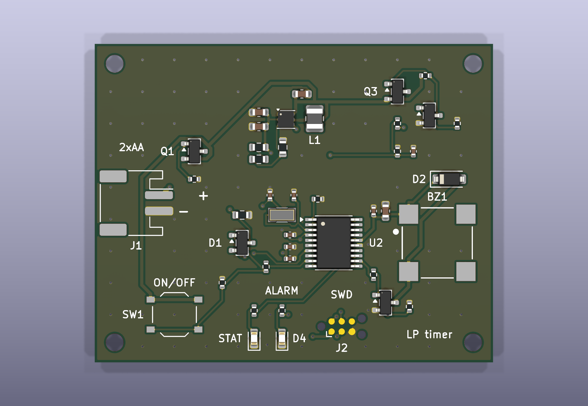
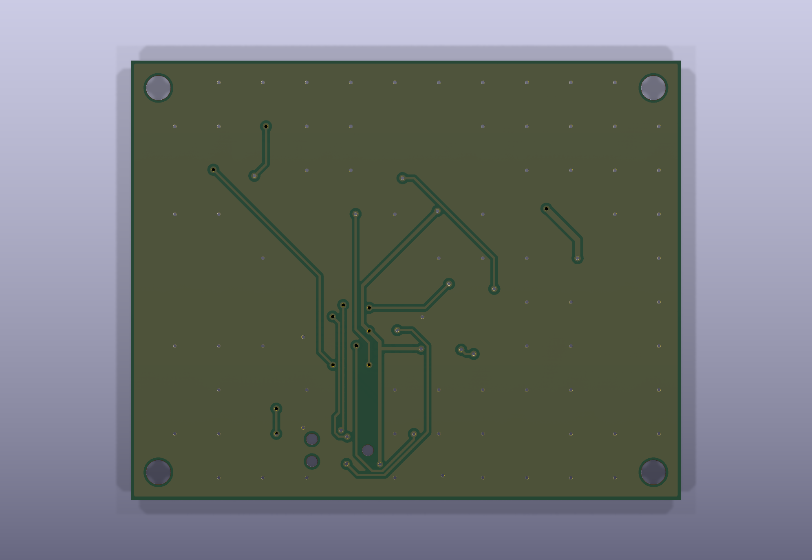

# Low-power battery timer (2×AA, soft-latch power button, STM32L0, 2-layer)

A 50 × 40 mm timer board that runs from two AA cells. One button turns it on; the firmware keeps itself powered
through a HOLD pin and turns itself off on a long press. When it is off, the battery sees only leakage, about 0.5 µA
typical. The board has a 32.768 kHz RTC, a magnetic buzzer, two LEDs and a switched battery-voltage divider. It is
a 2-layer board, and every part has an LCSC number for JLCPCB assembly.

| Top | Bottom |
|---|---|
|  |  |

Some parts render without bodies because their footprints have no 3D model.

## Files

| Path | What |
|---|---|
| `lowpower_timer.kicad_pro` / `.kicad_sch` / `.kicad_pcb` | the project (one A3 schematic sheet) |
| `lowpower_timer.pretty/` | project footprint for the Huaneng MLT-8530 buzzer |
| `docs/lowpower_timer_schematic.pdf` | schematic as PDF |
| `fab/gerber_jlcpcb.zip` | Gerber X2 (copper, mask, silk, paste, outline) and Excellon drill, PTH and NPTH |
| `fab/BOM_JLCPCB.csv`, `fab/CPL_JLCPCB.csv` | JLC BOM (Comment, Designator, Footprint, LCSC Part #) and placement file |
| `design/nets.json` | the intended connection of every pin, written by hand |
| `design/lowpower_timer.net`, `design/erc.json`, `reports/drc.json` | netlist, ERC and DRC reports from kicad-cli |
| `reports/route.dsn`, `reports/route.ses` | the Freerouting input and the routing result this board was built from |
| `tools/build_pcb.py` | builds the board from the netlist: placement, Freerouting, GND pours and stitching, silkscreen |
| `tools/export_fab.py` | writes `fab/`, the renders and the schematic PDF |
| `tools/check_netlist.py` | compares the netlist with `design/nets.json` pin by pin |
| `tools/cpl_rotations_db.csv`, `tools/cpl_rotations_local.csv` | CPL rotation corrections (see "Assembly") |

## Design

### Battery and reverse polarity
- Two AA cells in an external holder, on a JST-PH 2-pin connector (J1, pin 1 = +, marked on the silkscreen).
  A 2×AA holder is about 58 × 31 mm and would not fit a ≤ 50 × 40 mm board; a wired holder also lets the board sit
  in a lid.
- Q1, a DMG2305UX P-MOSFET, sits in the + lead (drain to the battery, source to VIN), with its gate to GND through
  R1 100 kΩ.
  - Cells the right way round: the body diode conducts first, then VGS = −VBAT turns the channel on. At end of life
    (VBAT = 1.8 V) VGS is −1.8 V, where RDS(on) is at most 200 mΩ, and VGS(th) is −0.5 to −0.9 V (DMG2305UX
    datasheet p.2). At about 200 mA input that is a 40 mV drop.
  - Cells reversed: the body diode is reverse-biased and VGS ≈ 0, so nothing conducts.
  - No series diode: a Schottky would cost 0.2–0.3 V of the 1.8 V left at end of life.

### 3.3 V boost
- U1 TPS61099 (adjustable, WSON-6 2 × 2 mm). It runs from 0.7 V input (datasheet p.5) and starts at 0.7 V with a
  light load (p.12).
- **Input above the output.** Two lithium AA cells reach 3.6 V, above 3.3 V. The TPS61099 handles that in Down mode:
  "In Down mode, the output voltage can still be regulated at target value even when input voltage is higher than
  the output voltage" (p.1). It only changes to Pass-Through, where VOUT follows VIN, when VIN > VOUT + 0.5 V (p.1),
  which is about 3.9 V here. So the output stays regulated for every AA chemistry; no buck-boost is needed.
- **Load disconnect is the reason for this part.** "In shutdown mode, the device stops switching and the rectifying
  PMOS fully turns off, providing the completed disconnection between input and output" (p.11; "True disconnection
  during shutdown", p.1). An ordinary boost lets VIN through the inductor and diode to VOUT while it is off, which
  would keep the MCU half-powered. The TPS61097A-33 was rejected because it does the opposite and connects the
  battery to the load in shutdown (its datasheet p.1).
- **Output voltage.** The 3.3 V-fixed TPS610994 is only sold on LCSC as a DSBGA, so the adjustable part sets the
  output with R2 + R3 (2 MΩ + 300 kΩ) over R4 (1 MΩ).
  - VOUT = VREF × (1 + 2.3 MΩ / 1 MΩ). VREF is 1.00 V in PWM (heavier loads) but 1.03 V in PFM at light load
    (datasheet p.5), so VOUT is 3.30 V when the buzzer runs and about **3.40 V while the board sleeps**.
  - Both are inside the STM32L031's 1.65–3.6 V range. The firmware must not assume a 3.3 V ADC reference: measure
    VDDA with the internal VREFINT channel before converting the battery reading.
  - The divider draws about 1 µA. TI suggests 100× the FB leakage for best accuracy (p.15); that holds against the
    10 nA typical leakage but not against the 50 nA maximum, which can push VOUT about 1 % high. Nothing on the
    board cares.
- L1 2.2 µH (Würth 74404024022, one of TI's listed parts; 2.2 µH is the recommended value for VOUT > 3 V, p.14).
  CIN 10 µF, COUT 2 × 10 µF (p.6: COUT 10 µF minimum, 20 µF nominal). The 0603 10 V X5R parts lose capacitance at
  3.4 V; at about 60 % retained, COUT is still ≈ 12 µF.

### Soft-latch power button
```
VIN ─SW1─┬─ BTN ──D1a──┐
         │             ├── EN (U1) ── R6 2M ── GND
         R5 1M  HOLD ──D1b┘   (D1 = BAT54C, common cathode)
         │      (PA1)
        GND   BTN ── R7 100k ── PA3 (button sense)
```
- **Press:** SW1 pulls BTN to VIN, D1a lifts EN, and the boost starts. The MCU boots and drives HOLD (PA1) high,
  which keeps EN high through D1b after the button is released.
- **Off:** the firmware sees a long press on PA3, **waits until the button is released**, and only then drives HOLD
  low. Dropping HOLD while the button is still held does nothing (EN stays high through D1a), and the board would
  come straight back on when the firmware rebooted.
- **EN at the lowest battery voltage:** pressing at VBAT = 1.8 V gives EN ≈ 1.8 V − 0.1 V (BAT54 at about 1 µA) =
  1.7 V. VIH is 1.2 V for VIN > 1.5 V, and 0.8 × VIN below that (datasheet p.6).
- **EN low when released:** the leakage current into the EN pin, IEN_LKG, is 50 nA max at VEN = 5 V (datasheet
  p.6; the FB pin has a separate 50 nA figure). Through R6 2 MΩ that is 0.1 V, under VIL = 0.4 V.
  - A 10 MΩ pull-down would have saved 1.3 µA in sleep, but in the worst case it could leave EN at 0.5 V, so it was
    not used.
- **Button sense:** PA3 is an FT (5 V-tolerant) pin (DS10668 Table 15 p.40), so BTN at 3.2–3.6 V is safe on it, and
  R7 limits the current if the MCU is unpowered during a press.
- **Diode leakage:** when the board is off, every node of the latch sits at 0 V, so the diodes carry no reverse
  current. When it is on, D1a is reverse-biased by about 3.3 V; BAT54C reverse current at 3 V is about 0.1 µA at
  25 °C and about 3 µA at 75 °C (Diodes BAT54 datasheet ds11005, Fig. 2 p.3, read off the curve). That counts in
  the sleep budget only.

### MCU and RTC
- U2 STM32L031F6P6 (TSSOP-20). I chose it over the ATtiny1616 for two reasons.
  - Stop mode with the RTC on the 32.768 kHz crystal draws about 0.55 µA at 3 V (DS10668 Fig. 18 p.63; the feature
    list on p.1 says 0.6 µA). The ATtiny1616's equivalent figure is 0.69 µA (DS40002204A Table 36-5 p.508).
  - The ATtiny's 32k oscillator wants CL 7.5–12.5 pF with ESR at most 40–80 kΩ (Table 36-14 p.512), and the common
    Epson crystal's 70 kΩ typical ESR sits at that edge.
  - SWD also gives breakpoint debugging.
- **Pin use:**

| Function | Pin |
|---|---|
| HOLD | PA1 (7) |
| Button sense | PA3 (9), FT |
| VBAT ADC | PA4 (10), ADC_IN4 |
| Battery-sense enable | PA5 (11) |
| Buzzer PWM | PA6 (12), TIM22_CH1, FT |
| LEDs | PA7 (13) / PB1 (14) |
| SWD | PA13 (19) / PA14 (20) |
| Unused, left open | PA0, PA2, PA9, PA10 |

  - BOOT0 is pulled to GND by R8 10 kΩ, and NRST has 100 nF to GND.
- **Crystal:** Y1 Epson FC-135, 32.768 kHz, CL = 7 pF; C0 1.0 pF typ, ESR 70 kΩ typ (FC-135 specification p.2).
  - Oscillator margin, after ST AN2867: gm_crit = 4 · ESR · (2π f)² · (C0 + CL)² = 4 · 70 kΩ · (2π · 32768 Hz)² ·
    (8 pF)² = 0.76 µA/V.
  - The L031's LSE "medium high" drive is rated for crystals up to 1.7 µA/V (DS10668 Table 40 p.71), so the
    firmware selects LSEDRV = 10, with 2.2× headroom.
  - The 12.5 pF version of the same crystal (JLC Basic) would need 2.16 µA/V, which only the highest drive level
    (2.7 µA/V) covers. That is 25 % headroom at typical ESR, and the crystal has no maximum ESR listed.
- **Load capacitors:** CL = C9·C10/(C9 + C10) + Cstray. With Cstray ≈ 3.5 pF (pin plus trace; an assumption, ST
  suggests 2–7 pF), C9 = C10 = 2 × (7 − 3.5) = 7 pF; 6.8 pF C0G is used. Trim with the RTC calibration register if
  needed.

### Battery voltage measurement
- Q3 (AO3401A) is a high-side switch in front of the R11/R12 100 kΩ / 100 kΩ divider. Q4 (2N7002) pulls Q3's gate
  down only while PA5 is high. R9 holds Q3 off and R10 holds Q4 off when the MCU is unpowered or in reset.
- Off, the divider draws nothing. Because it is cut off at the top, VBAT never reaches PA4 through it while the MCU
  is unpowered; a low-side switch would leave PA4 at VBAT through R11 and leak into the pin's protection diode.
- PA4 sees at most 1.8 V. C11 100 nF holds the node for the ADC sample.

### Buzzer and LEDs
- BZ1 Huaneng MLT-8530 magnetic buzzer: 2.7 kHz, 16 Ω coil, 95 mA max at 5 Vp-p (specification p.2).
  - It is driven exactly as its specification p.3 shows: NPN with a 470 Ω base resistor and a 1N4148 across the coil
    (Q5 MMBT3904, D2 1N4148W).
  - R14 100 kΩ keeps Q5 off while PA6 floats during reset.
- The footprint (`lowpower_timer.pretty`) uses the pad size and position of the official EasyEDA footprint for
  LCSC C94599 (2.4 mm square pads at ±3.6 mm). Pad 1 (+) is top-left and pad 2 (−) bottom-left, from the maker's
  outline drawing (specification p.2). The datasheet itself gives no land pattern.
- D3/D4 are red 0603 LEDs with 1 kΩ (≈ 1.3 mA each); red is the only JLC Basic 0603 LED.

### Programming
- SWD goes through a Tag-Connect TC2030-NL footprint (J2: 1 VCC, 2 SWDIO, 3 NRST, 4 SWCLK, 5 GND), which has no part
  to buy.
- J2's VCC is the 3.3 V rail, and with the board off that rail is disconnected from the battery. There are two ways
  to program:
  - **Power from the probe:** let the debugger supply 3.3 V into J2 pin 1. The TPS61099's true disconnect (p.1,
    p.11) keeps that from flowing back into the battery side.
  - **Power from the battery:** hold SW1 down for the whole programming session, or flash firmware that raises HOLD
    early.
- A blank MCU leaves PA1 floating, so on a first power-up from the battery the board stays on only while the button
  is held.

## Layout

- 2 layers, 1.6 mm, 50 × 40 mm, four M2 holes 2.5 mm in from the corners. Both layers have a GND pour, tied together
  by a grid of stitching vias (about 70) placed wherever one clears every other net.
- The boost sits at the top: L1 and the input capacitor next to the VIN/SW pins, the output capacitors and the FB
  divider next to the VOUT/FB pins. That keeps the switching loop short, away from the crystal.
- The crystal and its load capacitors sit right at PC14/PC15, with the VDDA, VDD and NRST capacitors on the same
  side of the MCU. The battery connector is on the left edge, and the button and LEDs on the bottom edge.
- Routing was done by Freerouting 2.5.0 from `reports/route.dsn`. `tools/build_pcb.py autoroute` repeats the run
  until the board, with its pours, has no unconnected item, and the SES that produced this board is kept in
  `reports/`.

Design rules (JLC 2-layer capability is 0.1/0.1 mm track/space, 0.3 mm via drill):

| Rule | Value |
|---|---|
| Clearance | 0.15 mm |
| Signal tracks | 0.2 mm |
| VIN / switch node / buzzer | 0.4 mm (still enters the 0.65 mm pitch WSON pads) |
| Battery input | 0.5 mm |
| Vias | 0.6/0.3 mm |
| Copper to edge | 0.3 mm |

Rebuild:
```
python tools/check_netlist.py design/lowpower_timer.net design/nets.json
"C:/Program Files/KiCad/10.0/bin/python.exe" tools/build_pcb.py place dsn autoroute silk
python tools/export_fab.py
```

## Current budget

### OFF (battery connected, boost disabled), VBAT 2.4–3.2 V

| Item | Typical | Datasheet maximum | Source |
|---|---|---|---|
| TPS61099 shutdown current into VIN | 0.5 µA | 1.6 µA (VIN 3.7 V) | TPS61099 datasheet p.5 |
| Q3 AO3401A off (IDSS) | not given | 1 µA (VDS −30 V) | AO3401A datasheet p.2 |
| Q4 2N7002 off (IDSS), through R9 | not given | 80 nA (VDS 60 V) | JSCJ 2N7002 datasheet (LCSC C8545) p.2 |
| Q1 gate leakage through R1 (VGS ≈ −VBAT) | not given | 100 nA (VGS ±8 V) | DMG2305UX datasheet p.2 |
| Button network, D1, R5, R6, R7 | 0 (all nodes at 0 V) | 0 | by construction |
| MCU, divider, buzzer, LEDs | 0 (VOUT disconnected) | 0 | TPS61099 p.11 |
| **Total** | **≈ 0.5 µA** | **≈ 2.8 µA** | |

The ≤ 1 µA target is met at typical values. The guaranteed maxima are specified at 8–60 V and 3.7 V, so they
overstate the worst case at 3.2 V, but no datasheet bounds it lower. Nothing has been measured.

### Sleep (on, MCU in Stop with RTC, HOLD high, everything else off), from the 3.4 V rail

| Item | Current | Source |
|---|---|---|
| STM32L031 Stop + RTC (LSE) | ≈ 0.55 µA | DS10668 Fig. 18 p.63 (measured with LSE low drive; medium-high drive adds an unquantified amount) |
| FB divider R2+R3+R4 | 1.03 µA | 3.4 V / 3.3 MΩ |
| EN pull-down R6 (EN ≈ 3.3 V) | 1.65 µA | 3.3 V / 2 MΩ |
| D1a reverse leakage (≈ 3.3 V) | 0.1 µA at 25 °C, ≈ 3 µA at 75 °C | Diodes ds11005 Fig. 2 p.3 |
| TPS61099 IQ from VOUT | 0.6 µA | TPS61099 datasheet p.5 |
| **Total on 3.4 V** | **≈ 3.9 µA** at 25 °C | |

From the battery at VIN 2.4 V: TPS61099 IQ from VIN is 0.4 µA (p.5). The efficiency curve gives 83 % at a 10 µA load
(VIN 2.5 V, VOUT 3.3 V, Fig. 6-5 p.7) and falls further at 4 µA; with an assumed 70 %, the battery current is
0.4 + 3.9 × 3.4 / (2.4 × 0.70) ≈ **8.3 µA**.

### Alarm (buzzer sounding, MCU running at 1 MHz, alarm LED on)

| Item | Current | Source |
|---|---|---|
| Buzzer, 2.7 kHz 50 % square wave | ≤ 95 mA (rated maximum at 5 Vp-p; lower at 3.3 V, not measured) | MLT-8530 spec p.2 |
| MCU Run, 1 MHz, Range 3 | 140 µA | DS10668 Table 24 p.57 |
| LED D4 | 1.3 mA | (3.3 − 2.0) V / 1 kΩ |
| **Total on 3.3 V** | **≤ 97 mA** | |

From the battery at 2.4 V and 93.6 % efficiency at 50 mA (Fig. 6-5 p.7, the nearest point read):
97 × 3.3 / (2.4 × 0.936) ≈ **143 mA** at most.

### Battery life with 2000 mAh AA cells

Example: always on, sleeping, with a 1 ms wake every second at 140 µA (+0.14 µA average) and 30 s of alarm per day.

| Part | Per day |
|---|---|
| Sleep, 8.4 µA × 24 h | 0.20 mAh |
| Alarm, 143 mA × 30 s | 1.19 mAh |
| **Total** | **≈ 1.4 mAh/day** |

- With 80 % of 2000 mAh usable, that is about 1150 days, **roughly 3 years**.
- At 140 mA an alkaline AA delivers noticeably less than its rated capacity, so the alarm share is optimistic.
- Switched OFF at 0.5 µA, the cells' own self-discharge (a few % per year) is larger than the board's draw.

## Assembly (JLCPCB)

- Upload `fab/gerber_jlcpcb.zip`: 2 layers, 1.6 mm.
- Assembly is top side only, with `fab/BOM_JLCPCB.csv` and `fab/CPL_JLCPCB.csv`. The mounting holes and the
  Tag-Connect pads are left out because there is nothing to place.
- **Rotations:** the CPL applies JLCKicadTools' correction table (`tools/cpl_rotations_db.csv`, copied unchanged
  from github.com/matthewlai/JLCKicadTools, GPL-3.0) plus `tools/cpl_rotations_local.csv`; the longest matching
  pattern wins.
  - Corrections applied: J1 +180°; SOT-23 parts (Q1, Q3, Q4, Q5, D1) −90°; U2 (TSSOP-20) +270°.
  - No table entry exists for U1 (WSON-6), Y1, L1, BZ1 or the passives, so those go at 0°.
  - **Check every part in JLC's placement preview before paying**, especially U1, BZ1 and Y1.
- Extended parts (one loading fee each): TPS61099, STM32L031, DMG2305UX, the 7 pF crystal, L1, the buzzer and the
  JST connector. Everything else is Basic or Preferred.

## Checks done (on this version)

- `kicad-cli sch erc` (10.0.8): 0 errors, 0 warnings (`design/erc.json`).
- `tools/check_netlist.py`: all 29 named nets match `design/nets.json` pin for pin, and every other pin is declared
  no-connect. On its first run it caught a real schematic short (LED2 to GND, from overlapping label stubs).
- `kicad-cli pcb drc --severity-all --schematic-parity --refill-zones` (10.0.8): **0 errors, 0 warnings, 0
  unconnected items, 0 schematic parity issues** (`reports/drc.json`).
- An independent review of the schematic led to these README corrections: Down mode and the Pass-Through
  threshold, VOUT 3.4 V in PFM and VREFINT in firmware, the power-off sequence, how to program a board that is off,
  the buzzer footprint against the EasyEDA footprint, and the 2N7002 / DMG2305UX leakage figures.

## Not checked

- Nothing has been built or measured: OFF current, sleep current, soft-latch timing, crystal start-up, buzzer
  current at 3.3 V.
- The buzzer polarity on the footprint comes from the maker's drawing. The EasyEDA footprint numbers its pads
  differently, and I did not see which of its pads it assigns to +.
- Efficiency below 10 µA load is an assumption (70 %); the datasheet curve stops at 10 µA.
- CPL rotations for parts with no correction-table entry (see "Assembly").
- No firmware is included; the power-off sequence and the VREFINT correction above are requirements for it.
